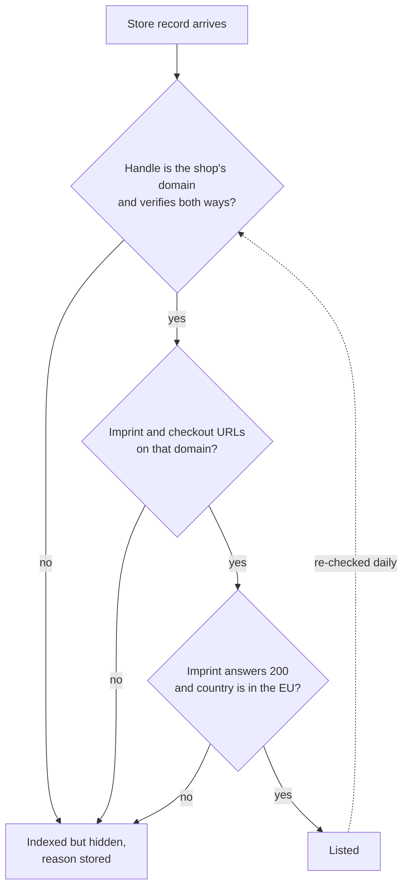

<h1 align="center">
  <picture><source media="(prefers-color-scheme: dark)" srcset="brand/logo-dark.svg"></picture>
</h1>

<p align="center"><strong>Search independent European shops. Buy on their own websites.</strong><br>An open product index on atproto. No cart, no commission, no ads, no tracking.</p>

<p align="center">
  <a href="docs/plan.md">Plan</a> ·
  <a href="lexicons/">Lexicons</a> ·
  <a href="appview/">Appview</a> ·
  <a href="brand/">Identity</a>
</p>

> **Status: proposal.** Nothing here is live. The plan, the lexicons and a first appview are public so they can be discussed.

## How it works

### Buying

Every item carries a checkout URL on the shop's own site. skycart shows the item; the button opens the shop. skycart never learns whether a purchase happened or for how much.

<p align="center"><picture><source media="(prefers-color-scheme: dark)" srcset="brand/diagrams/flow-dark.svg"></picture></p>

### Why that is different

A marketplace sits between buyer and shop, takes a commission and keeps the customer data. skycart is only an index.

<p align="center"><picture><source media="(prefers-color-scheme: dark)" srcset="brand/diagrams/compare-dark.svg"></picture></p>

### Architecture

Shops publish one store record and one record per item in their own atproto repository. The appview indexes them, checks each shop daily and serves search. Images come from the shop's own atproto server.

<p align="center"><picture><source media="(prefers-color-scheme: dark)" srcset="brand/diagrams/architecture-dark.svg"></picture></p>

<details>
<summary><strong>Protocol detail: when a shop is listed</strong></summary>



</details>

## Principles

| | |
|---|---|
| **No commission** | No listing fees either. Funding is meant to come from public grants and donations. |
| **No ads** | No sponsored placement. Ranking is text relevance plus a small boost for good verified-purchase reviews. |
| **No tracking** | No cookies, no analytics, no third-party requests. |
| **Shops keep their customers** | The sale, the data and the relationship stay with the shop. |
| **Open** | Code and lexicons are open source; anyone can run another appview. |

## Layout

| Path | Contents |
|---|---|
| `docs/plan.md` | the plan (authoritative) |
| `docs/shop-integration.md` | what a shop has to implement, including purchase proofs |
| `lexicons/eu/skycart/` | lexicon JSON: 5 record types, 7 XRPC methods, shared `defs` |
| `appview/` | Cloudflare Worker: XRPC API, Jetstream ingest (Durable Object), store checks (Queue + daily Cron), D1 schema in `migrations/0001_init.sql` |
| `brand/` | logo, mark and the identity notes |
| `site/` | static SvelteKit landing page (German and English) |

## Build

Requires Node and pnpm.

```sh
pnpm install
pnpm typecheck
pnpm build        # wrangler deploy --dry-run for appview, vite build for site
```

Nothing is deployed by these commands.

## Configuring the appview

`appview/wrangler.jsonc` contains placeholder IDs (D1 database) and the Jetstream URL. Replace the
placeholders before deploying. The only secret is `ADMIN_SECRET`, the bearer token for `/admin/*`
(see `appview/.dev.vars.example`); set it with `wrangler secret put ADMIN_SECRET` and never commit
its value.

## Ranking

`sort=relevance` orders results by the SQLite FTS5 bm25 score over title, description, brand and shop
name (lower is better), minus a small boost for the shop's average rating from verified-purchase
reviews: 0 for a 1-star average, rising linearly to 0.5 for a 5-star average. Shops with fewer than
three verified-purchase reviews get no boost. Nothing else influences ranking: no payment, no
sponsorship, no click data. The formula is one function, `relevance()` in
[`appview/src/ranking.ts`](appview/src/ranking.ts).

## License

[MIT](LICENSE)
