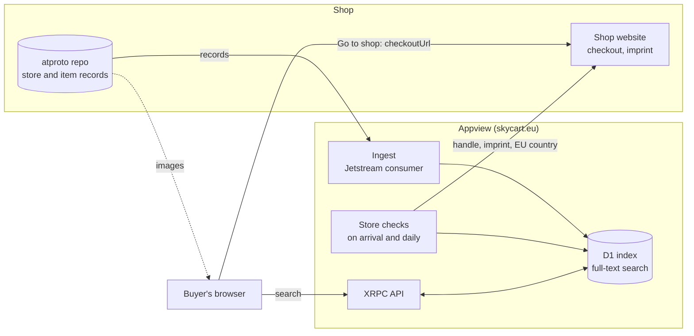
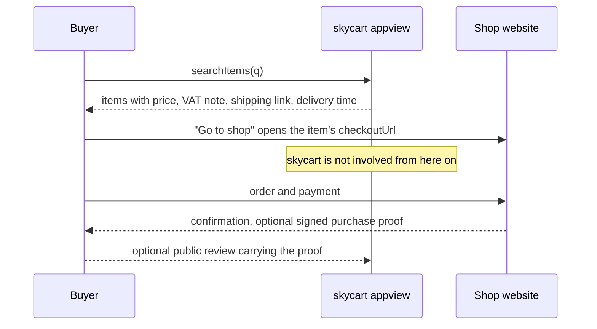
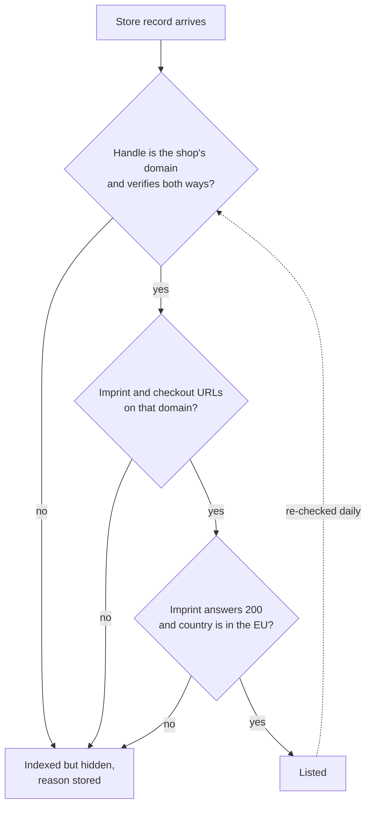

<p>
  <picture>
    <source media="(prefers-color-scheme: dark)" srcset="brand/logo-dark.svg">
    
  </picture>
</p>

# skycart.eu

**Status: proposal.** Nothing here is live.

An open product search engine for independent European shops, built on atproto. Shops publish a
store record and item records in their own atproto repository. The appview indexes them and offers
search, product pages, shop pages and reviews. Buying happens on the shop's own website through each
item's `checkoutUrl`: skycart has no cart, checkout, orders, accounts or payments, and no commission,
ads or tracking.

The specification is [`docs/plan.md`](docs/plan.md). Shops implement
[`docs/shop-integration.md`](docs/shop-integration.md).

## How it works

**Architecture**



**Buying**



**Listing a shop**



## Layout

| Path | Contents |
|---|---|
| `docs/plan.md` | the plan (authoritative) |
| `docs/shop-integration.md` | what a shop has to implement, including purchase proofs |
| `lexicons/eu/skycart/` | lexicon JSON: 5 record types, 7 XRPC methods, shared `defs` |
| `appview/` | Cloudflare Worker: XRPC API, Jetstream ingest (Durable Object), store checks (Queue + daily Cron), D1 schema in `migrations/0001_init.sql` |
| `brand/` | logo, mark and the identity notes |
| `site/` | static SvelteKit landing page (German and English) |

## Build

Requires Node and pnpm.

```sh
pnpm install
pnpm typecheck
pnpm build        # wrangler deploy --dry-run for appview, vite build for site
```

Nothing is deployed by these commands.

## Configuring the appview

`appview/wrangler.jsonc` contains placeholder IDs (D1 database) and the Jetstream URL. Replace the
placeholders before deploying. The only secret is `ADMIN_SECRET`, the bearer token for `/admin/*`
(see `appview/.dev.vars.example`); set it with `wrangler secret put ADMIN_SECRET` and never commit
its value.

## Ranking

`sort=relevance` orders results by the SQLite FTS5 bm25 score over title, description, brand and shop
name (lower is better), minus a small boost for the shop's average rating from verified-purchase
reviews: 0 for a 1-star average, rising linearly to 0.5 for a 5-star average. Shops with fewer than
three verified-purchase reviews get no boost. Nothing else influences ranking: no payment, no
sponsorship, no click data. The formula is one function, `relevance()` in
[`appview/src/ranking.ts`](appview/src/ranking.ts).

## License

[MIT](LICENSE)
